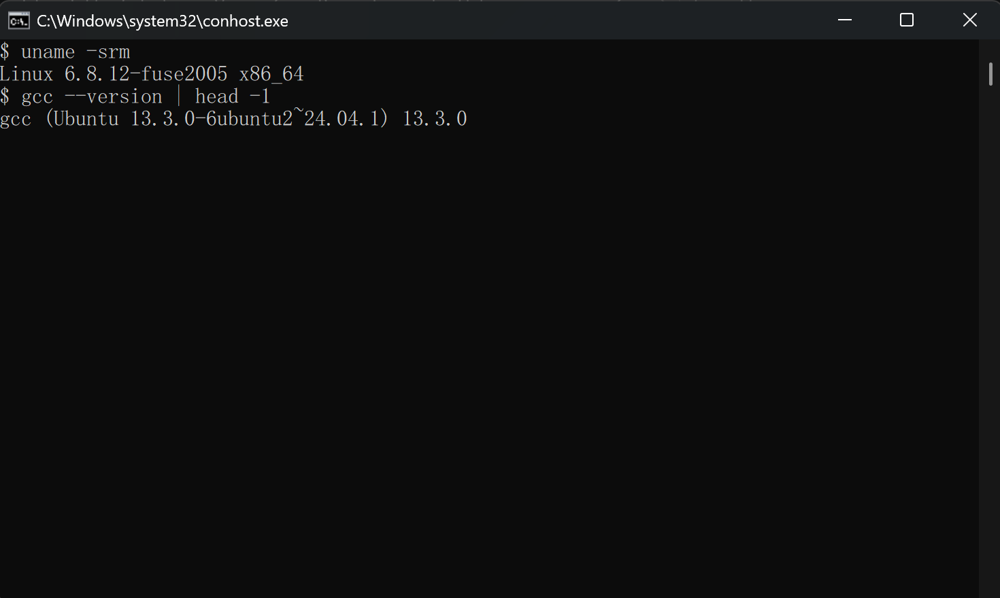
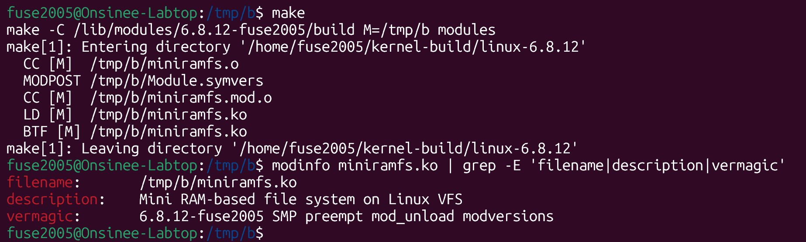
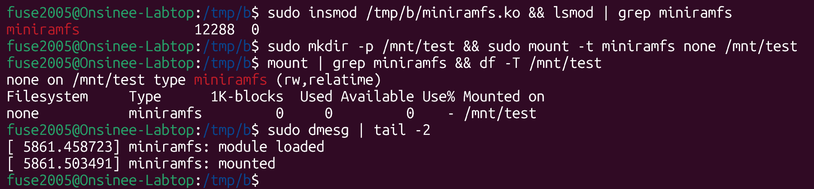
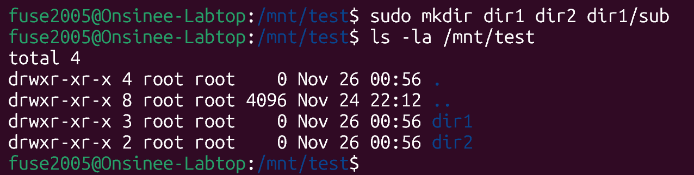
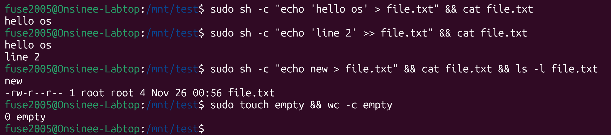
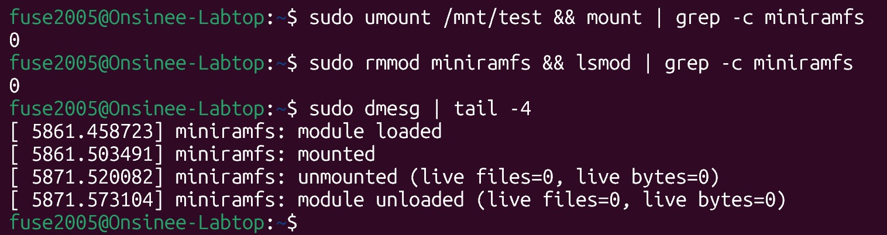
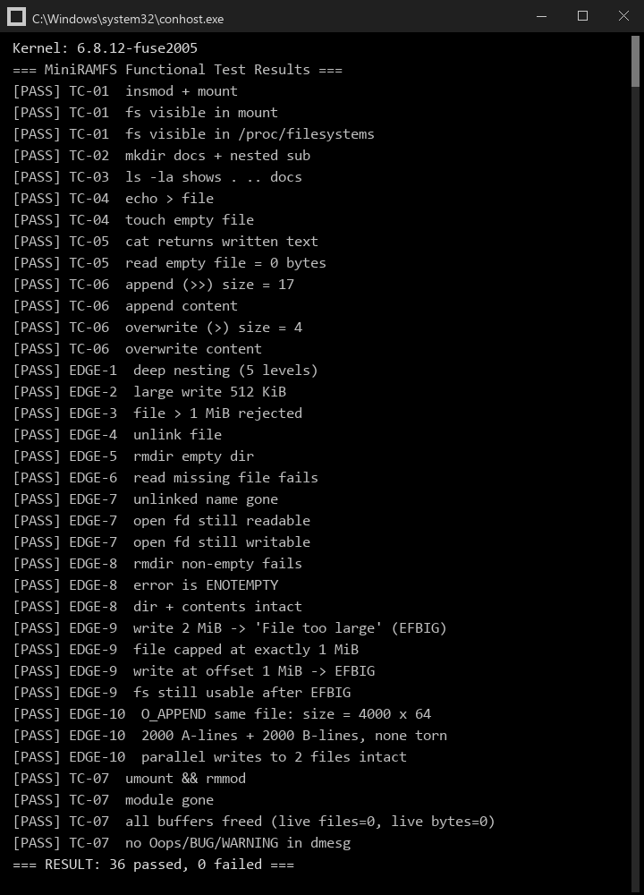
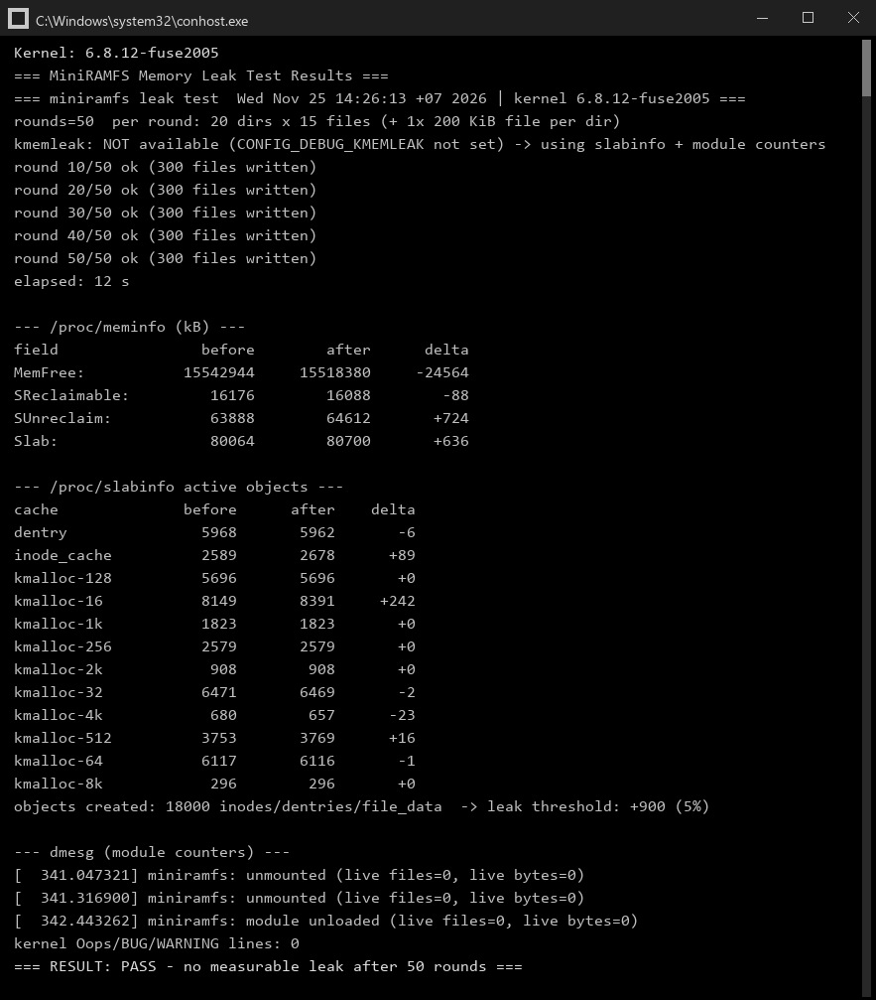

# Mini-Project 2: Mini RAM-Based File System

CPE333 Operating Systems · Topic: **I/O and File System** (Linux VFS)
ทีม: เจแปน, อุ๋งอิ๋ง, ผึ้ง, พอช, พิ้ง, ฟิวส์

> งานครั้งที่ 2 แยกจากงานครั้งที่ 1 ([`../mini-project-1/`](../mini-project-1/)) ทั้งหมด

## โครงสร้างโฟลเดอร์

```
mini-project-2/
├── README.md              ← ไฟล์นี้ (วิธี build/ทดสอบ)
├── PLAN.md                ← แผนงาน, หน้าที่ทีม, Test Plan, Script วิดีโอ
├── src/
│   ├── miniramfs.c        ← โค้ดหลัก (Milestone 1–3 ครบใน skeleton)
│   └── Makefile
├── tests/
│   ├── test_miniramfs.sh  ← TC-01..TC-07 + EDGE-1..10
│   ├── leak_test.sh       ← memory leak test 50 rounds
│   ├── demo.sh            ← demo for recording the clip (~2 min)
│   └── test_result.log
└── docs/
    ├── assignment.pdf     ← โจทย์จากอาจารย์
    ├── TESTING.md         ← คู่มือให้ทุกคนรันเทส + แคปภาพเอง
    ├── architecture.md    ← แผนผังฟังก์ชัน/struct (สำหรับบทที่ 3)
    ├── env.md             ← เวอร์ชัน gcc/kernel/headers
    └── screenshots/       ← ภาพผลทดสอบ / dmesg (เทอร์มินัลจริง)
        ├── CHECKLIST.md   ← screenshots each member must take
        └── logs/          ← test / leak / dmesg logs
```

## Build & Run (บน kernel 6.8.12-fuse2005 / Ubuntu 24.04 / WSL2)

```bash
cd src
make                                  # ได้ miniramfs.ko
sudo insmod miniramfs.ko
sudo mkdir -p /mnt/test
sudo mount -t miniramfs none /mnt/test
mount | grep miniramfs
# ... ใช้งาน mkdir / echo / cat / ls ...
sudo umount /mnt/test
sudo rmmod miniramfs
dmesg | tail
```

ทดสอบ (รันจากโฟลเดอร์ `mini-project-2/`):

| สคริปต์ | ทำอะไร | Log |
| :-- | :-- | :-- |
| `sudo bash tests/test_miniramfs.sh` | TC-01..TC-07 + EDGE-1..10 (36 checks) | `tests/test_result.log`, `docs/screenshots/logs/dmesg_test.log` |
| `sudo bash tests/leak_test.sh` | mount → 300 ไฟล์ → umount × 50 รอบ, เทียบ Slab/slabinfo | `docs/screenshots/logs/leak_test.log` |
| `sudo bash tests/demo.sh` | demo ถ่ายคลิป ~2 นาที (`DELAY=1` = ซ้อมเร็ว) | `docs/screenshots/logs/demo_output.log` |

Screenshot ที่แต่ละคนต้องถ่าย: `docs/screenshots/CHECKLIST.md`

ถ้า `make` ไม่เจอ build tree ให้ชี้เอง: `make KDIR=~/linux-6.8.12`
(ต้องเป็น tree ที่ใช้ build kernel ที่กำลังรันอยู่ และเคยรัน `make modules_prepare` / `modules_install`)

## Screenshots

**1. Environment**



**2. Build**



**3. Mount**



**4. mkdir / ls**



**5. File operations**



**6. umount / rmmod**



**7. Functional test (36/36 passed)**



**8. Memory leak test**



## สถานะ

- [x] Skeleton โค้ดครบ 7 operations (เขียนตาม API ของ kernel 6.8)
- [x] compile ผ่านบน 6.8.12-fuse2005 (0 error / 0 warning, ไม่ต้องแก้ miniramfs.c)
- [x] รัน test script ผ่านทุกข้อ (S4: 36/36 รวม EDGE-7..10, ดู `tests/test_result.log`)
- [x] Leak test 50 รอบผ่าน (live files=0, live bytes=0) และไม่มี Oops; log + dmesg อยู่ที่ `docs/screenshots/logs/`
- [x] ถ่าย screenshot ตาม `docs/screenshots/CHECKLIST.md`
- [ ] รายงาน / สไลด์ / วิดีโอ

## จุดที่ต้องตรวจเมื่อ compile (ขึ้นกับเวอร์ชัน kernel)

| จุด | ตรวจที่ |
| :-- | :-- |
| signature ของ `.create` / `.mkdir` / `.setattr` (`struct mnt_idmap *`) | `include/linux/fs.h` |
| `mount_nodev()` (API แบบเก่า; kernel ใหม่กว่านี้ให้ใช้ `fs_context`) | `include/linux/fs.h` |
| `simple_inode_init_ts`, `inode_set_ctime_current`, `inode_set_mtime_to_ts` (≥ 6.6/6.7) | `include/linux/fs.h` |
| ขนาดไฟล์สูงสุด 1 MiB เพราะใช้ `krealloc` (ไม่เกิน kmalloc limit) | `MINIRAMFS_MAX_FILE` |

## อ้างอิง

- https://docs.kernel.org/filesystems/vfs.html
- https://github.com/torvalds/linux/blob/master/fs/ramfs/inode.c (หรือไฟล์เดียวกันใน source 6.8.12 ของฟิวส์)
